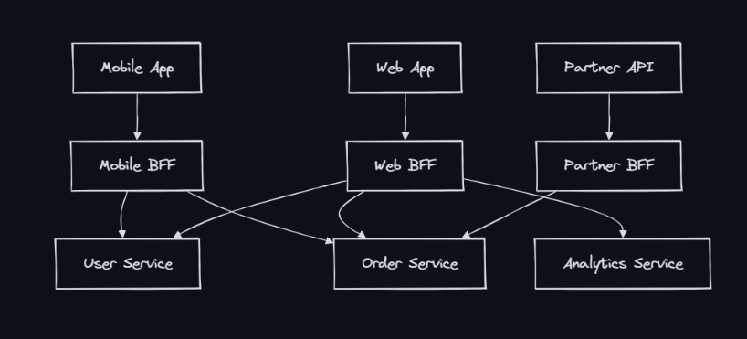
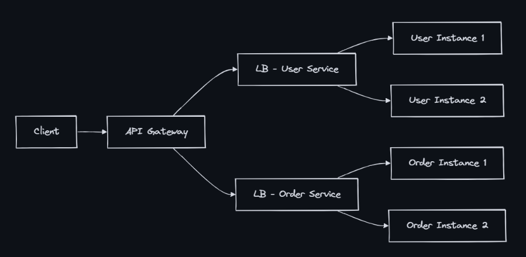

## API Gateway 
- An API Gateway is a single entry point for all client requests into a microservices architecture. It acts as a reverse proxy that routes requests to appropriate backend services while handling cross-cutting concerns like authentication, rate limiting, and response transformation.

- Why Use an API Gateway?
  - Without a gateway, every client must:
    - Know the address of every microservice 
    - Handle authentication with each service individually 
    - Make multiple round-trips to compose a single view 
    - Deal with different protocols (gRPC, REST, GraphQL)

### Gateway Responsibilities

- Routing: The gateway routes incoming requests to the appropriate microservice based on the request path, method, and other criteria (Map /api/users/123 to User Service, /api/orders to Order Service).
- Authentication: Validate JWT/OAuth tokens before forwarding
- Rate Limiting: Enforce per-user or per-IP request limits
- Request Transformation: Modify request payloads or headers to match the expected format of backend services (Convert REST to gRPC, add headers, rewrite paths)
- Response Aggregation: Combine responses from multiple services into a single response for the client (e.g., fetch user details and their orders in one request)
- Caching: Cache GET responses at the edge (The API gateway or CDN edge node (like Cloudflare or AWS API Gateway with caching enabled) stores the response of a GET request (e.g., public product listings, static user profiles))
- Circuit Breaking: Implement circuit breakers to prevent cascading failures when a service is down or slow (e.g., if the Order Service is down, return a fallback response instead of waiting for a timeout).
- Protocol Translation: Accept HTTP from clients, forward as gRPC internally
- SSL Termination: Handle TLS at the gateway, use plain HTTP internally(Terminate SSL connections at the gateway, reducing load on backend services and simplifying certificate management)
- Observability: Centralized logging, tracing, metrics for all traffic

### Backend for Frontend (BFF) Pattern
- Different clients have different needs. A mobile app needs compact responses; a web dashboard needs rich data. BFF provides a dedicated gateway per client type.

- BFF benefits:
  - Optimized response payloads per client (mobile gets less data)
  - Different auth flows (mobile = OAuth + biometric, web = session cookies)
  - Independent deployment per client team
  - Can aggregate multiple backend calls into one client-optimized response
  - **Used by**: Netflix (per-device BFF), SoundCloud, Spotify

### Popular API Gateway Implementations
- Kong:
  - Open-source + Enterprise
  - Plugin ecosystem (for authentication, rate limiting, logging), multi-cloud
- AWS API Gateway:
    - Managed service, integrates with AWS Lambda, supports REST and WebSocket APIs

    | feature | Rest api | http api | websocket api          |
    |---------|----------|----------|------------------------|
    | cost | $3.50 per million requests | $1.00 per million requests | $1.00 per million messages |
    |Latency | ~30ms | ~10ms | Persistent  connection |
    | Auth | IAM, Cognito, Lambda authorizers | JWT, IAM | Lambda authorizers |
    | Use Case | Full-featured | Simple proxy, low cost | Real time apps |

- NGINX:
  - Self-managed
  - High performance, custom configs

### Api Gateway vs Load Balancer

### Gateway Antipatterns
- God Gateway: A single gateway that handles too many responsibilities, leading to complexity and tight coupling with backend services. It becomes a bottleneck and a single point of failure.
  - Solution: Keep gateway thin; logic belongs in services
- Single gateway for all: One team’s deployment blocks others
  - BFF pattern or team-owned gateways
- No timeout: Slow backend hangs the gateway
  - Set aggressive timeouts + circuit breaker
- No rate limiting: One abusive client DoSes all clients
  - Implement rate limiting per client/IP (Per-tenant rate limits)
- Tight coupling: Gateway knows internal service schemas
  - Solution: Use abstraction layers or API contracts to minimize direct dependencies on internal service details.

