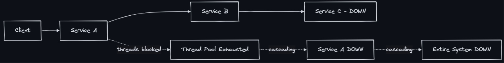
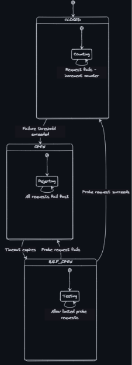
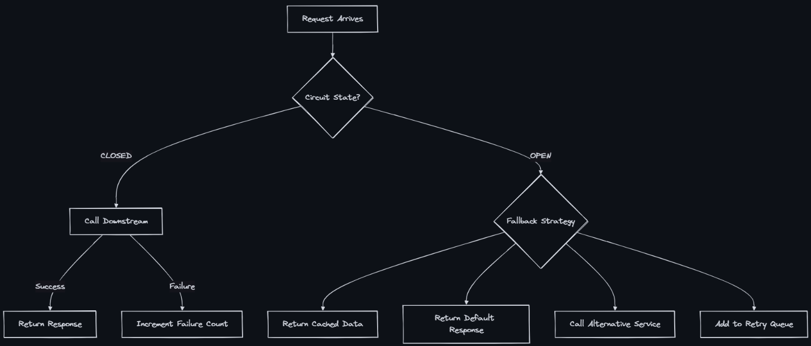

### Circuit Breaker Pattern
- A circuit breaker is a stability pattern that prevents a service from repeatedly calling a downstream dependency that is failing, giving the failing service time to recover instead of overwhelming it with requests.

### Why Do We Need It?
- Without a circuit breaker, when a downstream service is down:
    - Every request waits for a timeout (e.g., 30s)
    - Thread pool fills up with waiting threads
    - Your service becomes unresponsive
    - Upstream callers start timing out
    - Cascading failure takes down the entire system

### How It Works — The Three States
- The circuit breaker has three states that control whether requests pass through or get blocked:

- State: CLOSED
  - Behavior: All requests pass through. Failures are counted.
  - Transitions To: OPEN (when failure count exceeds threshold)
- OPEN:
  - Behavior: All requests fail immediately (no network call). Returns fallback.
  - Transitions To: HALF-OPEN (after timeout period)
- HALF-OPEN:
  - Behavior: Allows a limited number of probe requests through.
  - CLOSED (if probe succeeds) or → OPEN (if probe fails)

### Configuration Parameters
- Failure Threshold - Number of failures before opening - 5-10 failures
- Failure Rate (%) - Percentage of failures in sliding window - 50-60%
- Sliding Window Size - Number of calls to evaluate - 10-100 calls
- Wait Duration (Open) - Time to wait before transitioning to half-open - 30-60 seconds
- Permitted Calls (Half-Open) - Number of probe calls allowed - 3-5 calls
- Slow Call Threshold - Calls exceeding this duration count as failures - 2-5 seconds

### Fallback Strategies
- When the circuit is OPEN, you need a fallback:

- Cached response - Data doesn’t change frequently - Return last known user profile
- Default value - Acceptable degradation - Show 0 recommendations instead of personalized
- Alternative service - Redundant dependencies - Switch from primary to secondary payment provider
- Queue for later - Non-critical operations - Buffer notifications for retry
- Graceful error - No reasonable fallback - “Service temporarily unavailable, try again later”

### Libraries and Implementations
- Resilience4j - Java - Modern, lightweight, functional API
- pybreaker - Python - Simple circuit breaker