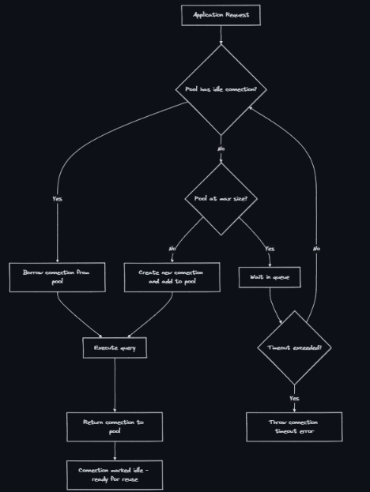

### Connection Pooling 
- Connection pooling is a technique of maintaining a set of pre-established database connections that are reused across requests, instead of creating a new connection for every query and closing it when done.

### Why Are Connections Expensive?
- Creating a new database connection involves:
  1. DNS resolution - 1-5 ms
  2. TCP handshake (SYN/ACK) - 1-3 ms
  3. TLS handshake (if SSL) - 5-30 ms
  4. Authentication (username/password) - 2-10 ms
  5. Server allocates memory for session - 5-10 MB per connection
  6. Connection ready - Total: 10-50 ms
- For a web request that needs a 2ms query, spending 30ms on connection setup is 15x overhead. At 1000 RPS, that’s 1000 connections created and destroyed per second — massive waste.

### How Connection Pooling Works

- Pool lifecycle:
  - Initialization: Pool creates minIdle connections at startup
  - Borrow: Application requests a connection → pool hands one out
  - Use: Application executes queries
  - Return: Application returns connection to pool (not closed)
  - Validation: Pool checks if returned connection is still alive
  - Eviction: Idle connections beyond minIdle are closed after idleTimeout

### Pool Sizing: The Formula
- The optimal pool size is NOT “more is better.” Too many connections actually hurt performance:
- Formula (from PostgreSQL wiki and HikariCP docs):
```
Pool Size = (Number of CPU cores × 2) + Number of Disk Spindles
```
For SSD-backed databases, a good starting point:
```
Pool Size = CPU cores × 2 + 1
```
- Why small pools are better:
  - Too small (5): Requests queue up, high latency under load
  - Optimal (10-20): Max throughput, CPU and disk fully utilized
  - Too large (200): Context switching overhead, lock contention, WORSE throughput
- A PostgreSQL server with 4 cores typically performs best with a pool of 9-10 connections, not 200.

### Pool Configuration Parameters
- maxPoolSize: Maximum connections in pool - 10-30 (depends on DB cores)
- minIdle: Connections kept alive when idle - 5-10
- connectionTimeout: Max wait time for a connection - 3-10 seconds
- idleTimeout: Close idle connections after this - 10-30 minutes
- maxLifetime: Force close after this (prevent stale) - 30-60 minutes
- validationQuery: Query to test if connection is alive - SELECT 1
- leakDetectionThreshold: Log if connection not returned after - 30-60 seconds

### Application-Side vs Proxy-Side Pooling
- Application-Side (HikariCP):
  - Where: Inside each app instance
  - Total connections: N instances × pool size
  - Use case: Fixed number of app instances
  - Problem: 50 instances × 20 pool = 1000 DB connections
  - Complexity: None (library config)
- Proxy-Side (PgBouncer):
  - Where: Separate process between app and DB
  - Total connections: Shared pool, fewer DB connections
  - Use case: Many instances or serverless (Lambda)
  - Problem: Multiplexes to fewer actual DB connections
  - Complexity: Extra infrastructure to manage

### Connection Leaks
- A connection leak occurs when application code borrows a connection but never returns it. The pool gradually runs out of available connections until all requests block.
- Common causes:
  - Exception thrown before connection.close() in finally block
  - Missing try-with-resources
  - Long-running transactions holding connections
  - Forgetting to close in async code paths
- Detection and prevention:
  - Set leakDetectionThreshold (HikariCP logs a warning with stack trace)
  - Monitor pool metrics: active vs idle connections
  - Use try-with-resources (Java) or context managers (Python)
  - Set a hard maxLifetime to force-close stale connections

### Connection Pooling with Serverless
- Serverless (Lambda) creates a new problem: each Lambda invocation might open a new connection, and thousands of concurrent invocations can exhaust DB connection limits.
- Lambda functions spin up to handle a request and then spin down or sit idle. If 5,000 users hit your app simultaneously, AWS might automatically spin up 5,000 separate Lambda container instances (spring apps) to handle them.
- Solutions:
  - RDS Proxy: Sits between Lambda and DB, multiplexes connections
  - PgBouncer: External pooler shared across all Lambda instances
  - Connection reuse: Initialize connection outside handler, reuse across warm invocations
  - DynamoDB: Avoid the problem entirely (HTTP-based, no persistent connections)

