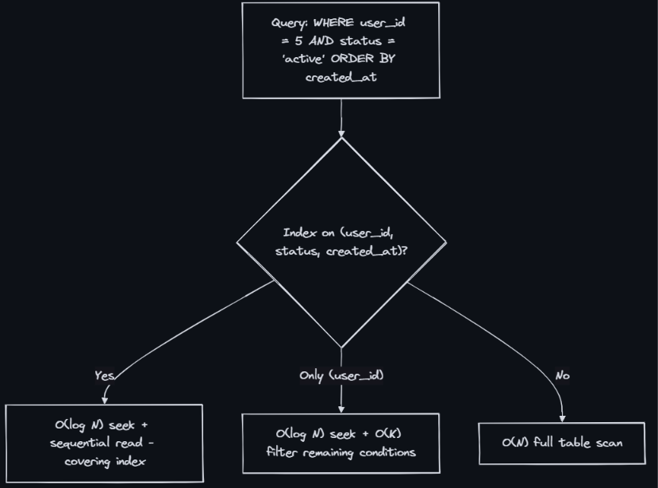
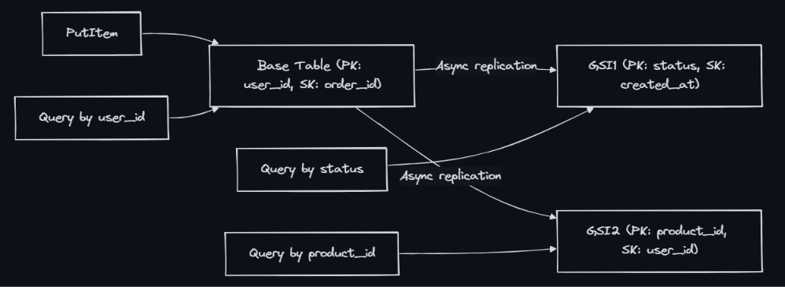
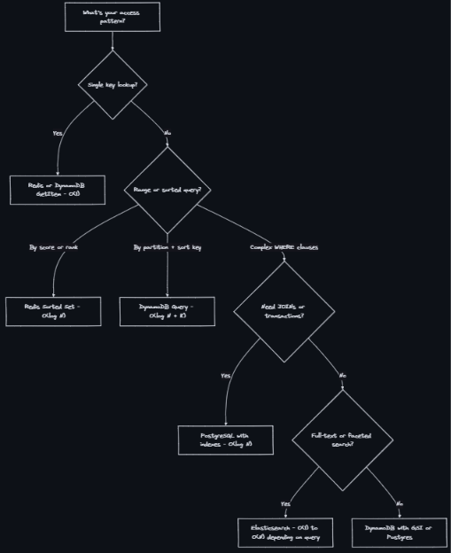

### Database Query Complexity
- Query complexity describes the time and resource cost of database operations relative to the data size. In system design, knowing whether an operation is O(1), O(log N), or O(N) determines whether your design works at scale — the difference between 1ms and 10 seconds for 100M rows.

### PostgreSQL Query Complexity
- Without Index (Sequential Scan):
  - ```SELECT * FROM users WHERE email = ?``` == O(N) == Full table scan — checks every row
  - ```SELECT * FROM users WHERE age > 25``` == O(N) == Range scan without index — checks every row
  - ```SELECT * FROM users ORDER BY created_at LIMIT 10``` == O(N log N) == Sort entire table, then take 10
  - ```SELECT COUNT(*) FROM users``` == O(N) == Must scan all rows (MVCC (Multi-Version Concurrency Control))
  - ```INSERT INTO users VALUES (...)``` == O(1) == Append to heap (no index maintenance)
  - ```UPDATE users SET name = ? WHERE id = ?``` == O(N) == Find row (scan) + update
  - ```DELETE FROM users WHERE id = ?``` == O(N) == Find row (scan) + mark dead
- With B-Tree Index:
  - ```SELECT * WHERE id = ?``` (Primary Key)	== O(log N) == B-tree traversal to leaf
  - ```SELECT * WHERE email = ? (Unique Index)``` == O(log N) == Index seek + heap fetch
  - ```SELECT * WHERE age > 25 (Index on age)``` == O(log N + K) == Seek + scan K matching rows
  - ```SELECT * ORDER BY created_at LIMIT 10 (Indexed)``` == 	O(log N) == Index already sorted; read first 10
  - ```INSERT (with indexes)``` == O(log N) per index == Insert row + update each B-tree
  - ```UPDATE (indexed column)``` == 	O(log N) == Find via index + update index entries
  - ```SELECT COUNT(*) (no WHERE)``` == 	O(N) == Still scans — Postgres MVCC has no exact count

- What is MVCC?
  - MVCC is the concurrency control mechanism PostgreSQL uses to manage simultaneous reads and writes without locking tables.
  * **Core Rule:** Readers never block writers, and writers never block readers.
  * Instead of locking rows to update them, Postgres maintains multiple physical versions of the same logical row concurrently, allowing each transaction to see a consistent snapshot of the data.
- The Core Metadata: `xmin` and `xmax`
  - Every physical row (tuple) stored on disk has two hidden system columns representing **Transaction IDs (XIDs)** (incrementing 32-bit integers):
  * **`xmin` (The Birth ID):** The ID of the transaction that *created* (inserted) this exact row version.
  * **`xmax` (The Death ID):** The ID of the transaction that *deleted* or *superseded* (updated) this row version.
      * If the row version is currently active/alive, **`xmax` is `0`**.
- How Operations Work Under the Hood
  - A. Insert: Postgres creates a new physical row on disk.
      * Sets **`xmin`** = Current Transaction ID.
      * Sets **`xmax`** = `0`.
  - B. Update (Not In-Place): Postgres **never** overwrites existing data on disk during an update. An update is a combined `INSERT` + `DELETE`:
    1. It locates the current active row version and writes the current transaction ID into its **`xmax`** (marking it as "killed" by this transaction).
    2. It immediately writes a **brand-new physical row version** right next to it on disk with:
       * **`xmin`** = Current Transaction ID
       * **`xmax`** = `0`
       * *Example:* If user `id = 1` changes name from `'Alice'` to `'Bob'`, disk holds two rows:
         1. `[id: 1, name: 'Alice', xmin: 100, xmax: 200]` *(Dead)*
         2. `[id: 1, name: 'Bob',   xmin: 200, xmax:   0]` *(Alive)*
  - C. Read (Visibility Snapshots): When a `SELECT` query runs, it receives a transaction snapshot. It scans the table and evaluates every row's `xmin` and `xmax` against its snapshot rules:
      * It skips rows created by future transactions or killed by transactions committed before its snapshot.
      * It finds the exact row version that is valid and visible for its specific timeline.
- Preventing Bloat: Autovacuum & HOT Updates:
  - A. Autovacuum (Garbage Collection)
    * As updates and deletes accumulate, dead row versions (dead tuples) pile up on disk.
    * A background worker process (`autovacuum`) periodically scans tables, cleans up dead tuples, and marks those disk slots as available for reuse by future `INSERT` statements.\
  - B. HOT (Heap-Only Tuple) Updates: 
    * **The Problem:** If every update creates a new row address, every index pointing to that row would also need updating (destroying write performance).
    * **The Solution:** If you update a column that is **not** indexed (e.g., updating `address` instead of `email`), Postgres performs a **HOT Update**:
    * It places the new row version on the **exact same physical disk page** as the old row.
    * It creates an internal chain pointer from the old row to the new row.
    * **Result:** **No indexes need to be updated**, saving massive I/O overhead.
- Why `SELECT COUNT(*)` Takes $O(N)$ Time Complexity: 
  * In PostgreSQL, there is **no single global row count** stored in metadata.
  * Because concurrent transactions see different realities based on their snapshot visibility rules (Transaction A might see 10M rows while Transaction B sees 10,008 rows), the database must physically scan the table (or use index-only scans with visibility maps) and evaluate the `xmin`/`xmax` of every tuple.
  * Therefore, counting rows scales linearly with table size: **$O(N)$**.

- Composite index rules (leftmost prefix):
  - Index on (A, B, C) supports: WHERE A = ?, WHERE A = ? AND B = ?, WHERE A = ? AND B = ? AND C = ?
  - Does NOT efficiently support: WHERE B = ? alone, WHERE C = ? alone
  - Range condition stops further index usage: WHERE A = ? AND B > 5 AND C = ? — C cannot use the index

### DynamoDB Query Complexity
- How Data is Stored & Hashed via PK:
  * **JSON Document Structure:** Data is stored as flexible key-value pairs (documents) rather than rigid relational tables.
  * **Partition Key (PK) Hashing:** Every unique Partition Key is passed through a hash function.
  * **Physical Routing:** The hash value acts as an address, routing the item directly to a specific physical storage partition on a cluster. Zero manual indexing is required.
- Why Hashing Grants $O(1)$ Time Complexity:
  * **Bypassing Scans:** Relational DBs scan tables or traverse B-Tree index trees ($O(\log N)$ or $O(N)$). DynamoDB's hash function instantly maps the PK to the exact storage node.
  * **Constant Time ($O(1)$):** Whether your table has 10 items or 10 billion items, a point lookup (`GetItem`) takes the exact same number of steps: **Hash the key $\rightarrow$ Go to the physical node $\rightarrow$ Fetch data.**
- Example:
  * **Operation:** `GetItem` for `PK = "USER#123"` on a table containing **10 billion rows**.
  * **What Happens:**
    1. The database passes `"USER#123"` through its hash function.
    2. The resulting hash instantly points to **Partition Node #42** out of thousands of cluster nodes.
    3. It fetches the record directly from that single node's memory/disk in a single step.
  * **Result:** **$O(1)$ time complexity.** It completely ignores the other 9.99 billion rows on other partitions.
- In DynamoDB, performance and cost are rigidly tied to Read Capacity Units (RCUs) and Write Capacity Units (WCUs):
  - 1 RCU = 1 strongly consistent read per second for an item up to 4KB. 
  - 1 WCU = 1 write per second for an item up to 1KB. If your app spikes and exceeds your provisioned units, DynamoDB throws a ProvisionedThroughputExceededException instantly, throttling your requests.

| Core Operations | Complexity | Cost (RCU/WCU) | Explanation |
|---|---|---:|---|
| GetItem(PK) | O(1) | 1 RCU (4KB strongly consistent) | Direct hash lookup |
| GetItem(PK, SK) | O(1) | 1 RCU | Hash + exact sort key |
| Query(PK, SK begins_with) | O(1) + O(K) | K × RCUs | Hash lookup + sorted scan of K items |
| Query(PK, SK between) | O(1) + O(K) | K × RCUs | Hash lookup + range within sort key |
| Scan(full table) | O(N) | N × RCUs | Reads every item — avoid in production |
| PutItem | O(1) | 1 WCU (1KB) | Direct hash write |
| UpdateItem | O(1) | 1 WCU | In-place update by primary key |
| DeleteItem | O(1) | 1 WCU | Direct hash delete |
| BatchGetItem (up to 100) | O(K) | K × RCUs | Parallel GetItem calls |
| TransactWriteItems (up to 100) | O(K) | 2K × WCUs | ACID transaction (2x cost) |

- Global Secondary Index (GSI): 
  - If your table is partitioned by UserID, what happens when a customer service agent searches for an order by its OrderID or an admin searches for a user by their Email?
  - Without a GSI, your only options are a full table scan ($O(N)$), which is a production anti-pattern.
  - With a GSI, you create a secondary "virtual table" that is indexed by that new attribute (OrderID or Email), allowing fast $O(1)$ lookups on attributes that are not your primary key.

| Operation | Complexity | Notes |
|---|---|---|
| Query on GSI | O(1) + O(K) | Same as base table query on different key |
| Scan on GSI | O(N) | Same cost as base table scan |
| Write to table with GSI | O(1) + O(G) per GSI | Each GSI is an async copy — eventual consistency |


- Key DynamoDB rules:
  - Every query MUST include the partition key (PK) — no way around this
  - Sort key (SK) enables range queries within a partition
  - GSI lets you query by a different attribute — but adds write cost and eventual consistency
  - Scan is always O(N) — design your keys to avoid it

### Redis Query Complexity
- The $O(1)$ Safe Zone (Use Freely):
  - Commands: GET/SET, HGET/HSET, SADD/SISMEMBER, LPUSH/LPOP.
  - These operate directly on hash tables or pointers. They take microsecond execution times and can handle hundreds of thousands of operations per second safely.
- The $O(\log N)$ Powerhouse (Sorted Sets):
  - Commands: ZADD, ZRANGE, ZRANK
  - This is your go-to structure for Leaderboards, Rate Limiters, and Priority Queues. Because it maintains sorted order via a skip list, finding a rank or slicing the top 10 items out of millions scales logarithmically ($O(\log N + K)$), making it lightning-fast.
-  The $O(N)$ Production Killers (The Danger Zone):
  - Commands: KEYS *, HGETALL (on huge hashes), SMEMBERS (on massive sets), FLUSHALL.
  - Remember that Redis's command execution engine is single-threaded. If you run an $O(N)$ command on a collection with 5 million items, it blocks the entire server. Every other user request, API call, and cache lookup halts completely until that $O(N)$ command finishes.

### Decision Framework: “How Will You Query This?”


### Composite Index Design Rules
- Equality first - Put = conditions before range - (status, created_at) not (created_at, status)
- High cardinality first - More selective column first (for equality) - (user_id, status) not (status, user_id)
- Range column last - Only one range per composite index - (user_id, status, price) — range on price only
- Cover the query - Include SELECT columns to avoid heap fetch - (email) INCLUDE (name, avatar)
- Match ORDER BY - Index order must match sort direction - (created_at DESC) for ORDER BY created_at DESC
