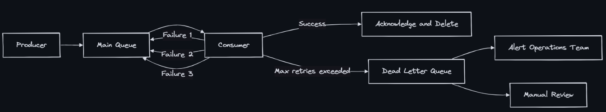
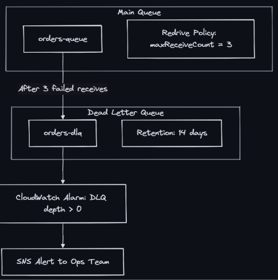
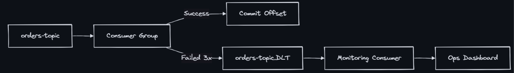
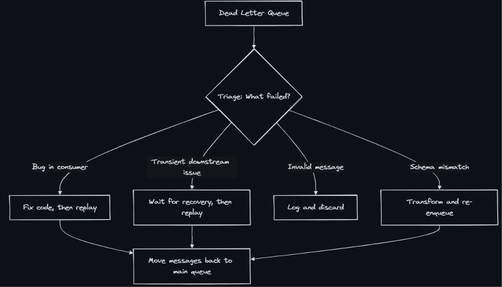

### Dead Letter Queue (DLQ)
- A Dead Letter Queue (DLQ) is a special queue where messages that cannot be processed successfully after multiple attempts are moved. It isolates “poison” messages so they don’t block the main processing pipeline, while preserving them for investigation and potential reprocessing.

### Why DLQ Exists

- Without a DLQ:
    - Poison messages block the queue (head-of-line blocking)
    - Consumer retries infinitely, wasting compute
    - Other valid messages behind the poison message are delayed
    - No visibility into what’s failing or why
- With a DLQ:
    - Poison messages are isolated after N attempts
    - Main queue continues processing healthy messages
    - Operations team gets alerts on DLQ depth
    - Failed messages are preserved for debugging and reprocessing

### Poison Messages
- A poison message is one that will NEVER be processed successfully, regardless of retries:
    - Schema mismatch - Producer sends v2 schema, consumer expects v1
    - Invalid data - Null field where non-null required, malformed JSON
    - Missing dependency - Message references entity that was deleted
    - Bug in consumer - Unhandled edge case causes exception
    - Size limit - Payload exceeds consumer’s memory limit
    - Expired context - Message is too old to be meaningful

### SQS DLQ Configuration
- Amazon SQS has native DLQ support via redrive policy.

    - maxReceiveCount - 3-5 typically - Attempts before moving to DLQ
    - MessageRetentionPeriod (DLQ) - 14 days - Time to investigate before message expires
    - VisibilityTimeout (main queue) - 30s-5min - Time consumer has to process before retry
- SQS redrive allow policy: Controls which source queues can send to a DLQ. Prevents accidental routing.
- SQS DLQ redrive (replay): Since 2021, SQS supports moving messages FROM the DLQ BACK to the source queue for reprocessing — no custom code needed.

### Kafka Dead Letter Topics
- Kafka doesn’t have native DLQ support, but the pattern is implemented at the consumer level.

- Implementation approaches:
    - Spring Kafka DLT - @RetryableTopic with dlt suffix topic auto-created - Easy but Spring-specific
    - Manual producer - Consumer catches exceptions, publishes to DLT topic manually - Full control, more code
    - Kafka Connect DLQ - Connectors have built-in errors.deadletterqueue.topic.name - Only for Connect pipelines
    - Retry topics - Chain: main → retry-1 (1min delay) → retry-2 (5min) → DLT - Graduated retry delays
- Kafka retry topics pattern (Uber-style):
    ```
    orders-topic → orders-topic.retry-1 (delay 1min) → orders-topic.retry-2 (delay 10min) → orders-topic.DLT
    ```
  
### Monitoring and Alerting
- DLQ depth - > 0 messages - Investigate immediately
- DLQ growth rate - > 10 messages/min - Likely systemic bug, not isolated poison message
- DLQ age - Oldest message > 24h - Messages aging out without review
- DLQ as % of total - > 1% of throughput - Consumer has a significant bug
- Main queue age - Messages not being consumed - Consumer might be down
- Alert escalation:
    - DLQ depth > 0 → Slack notification to team channel
    - DLQ depth > 100 → PagerDuty alert to on-call
    - DLQ growth rate sustained > 1min → Auto-pause producer (circuit breaker)

### Reprocessing Strategies

- Reprocessing options:
    - Automatic replay - Known transient issue; replay after cooldown period
    - Manual replay - After code fix deployed; ops triggers replay
    - Selective replay - Filter DLQ messages by criteria; replay subset
    - Transform and replay - Fix message format before re-enqueue
    - Discard with logging - Message is truly unprocessable; log for audit trail
    - Side-channel processing - Special handler processes DLQ differently than main consumer

### DLQ in Practice: Design Patterns
1. DLQ with Metadata Enrichment: When moving to DLQ, attach diagnostic metadata:
    - Original queue/topic name
    - Number of processing attempts
    - Error message from last failure
    - Timestamp of first failure
    - Consumer instance that failed

2. Tiered Retry with DLQ
    ```
    Attempt 1 → immediate retry
    Attempt 2 → retry after 1 minute (delay queue)
    Attempt 3 → retry after 10 minutes (delay queue)
    Attempt 4 → DLQ (human review)
    ```

3. DLQ Consumer (Auto-healing): A separate consumer watches the DLQ and periodically attempts reprocessing with a different strategy (e.g., relaxed validation, fallback service). Only truly unprocessable messages remain.