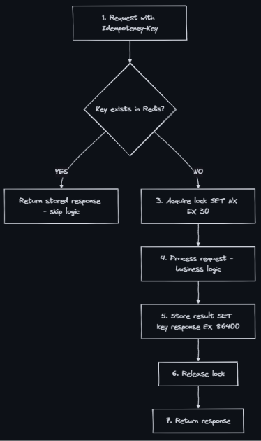

### Idempotency
- An operation is idempotent if performing it multiple times produces the same result as performing it once. No matter how many times you retry, the side effect happens exactly once.
    ```
    Idempotent:
      SET balance = 100        (do it 5 times → balance is still 100)
      DELETE /orders/123       (do it 5 times → order is still deleted)
      PUT /users/123 {name: X} (do it 5 times → name is still X)
    
    NOT Idempotent:
      balance += 100           (do it 5 times → balance increases by 500!)
      POST /orders {items:[]}  (do it 5 times → 5 orders created!)
      INSERT INTO ledger(...)  (do it 5 times → 5 rows inserted!)
    ```

### Why Does It Matter?
- In distributed systems, requests can be retried:
- Without idempotency: Network failures, timeouts, load balancer retries, and message queue redelivery all cause duplicate processing.

### Idempotency Keys — The Solution
- Client generates a unique key per logical operation. Server uses it to detect retries.
    ```
    First attempt:
      POST /payments
      Idempotency-Key: "pay_a1b2c3d4e5f6"
      { "amount": 100, "to": "merchant_xyz" }
    
      Server: key "pay_a1b2c3d4e5f6" not seen before
              → process payment → store result with key
              → return 200 { "paymentId": "pm_789" }
    
    Retry (network timeout on first attempt):
      POST /payments
      Idempotency-Key: "pay_a1b2c3d4e5f6"    ← same key!
      { "amount": 100, "to": "merchant_xyz" }
    
      Server: key "pay_a1b2c3d4e5f6" found!
              → return stored result: 200 { "paymentId": "pm_789" }
              → NO duplicate payment created
    ```
  
### Implementation with Redis

```java
import com.fasterxml.jackson.core.JsonProcessingException;
import com.fasterxml.jackson.databind.ObjectMapper;
import org.springframework.data.redis.core.RedisTemplate;
import org.springframework.data.redis.core.script.DefaultRedisScript;

import java.time.Duration;
import java.util.List;
import java.util.UUID;

public class PaymentHandler {
    private static final Duration LOCK_TTL = Duration.ofSeconds(30);
    private static final Duration RESULT_TTL = Duration.ofHours(24);

    private static final DefaultRedisScript<Long> RELEASE_LOCK_SCRIPT =
        new DefaultRedisScript<>(
            "if redis.call('get', KEYS[1]) == ARGV[1] then " +
            "return redis.call('del', KEYS[1]) else return 0 end",
            Long.class
        );

    private final RedisTemplate<String, String> redis;
    private final ObjectMapper objectMapper;
    private final PaymentService paymentService;

    public PaymentHandler(
            RedisTemplate<String, String> redis,
            ObjectMapper objectMapper,
            PaymentService paymentService) {
        this.redis = redis;
        this.objectMapper = objectMapper;
        this.paymentService = paymentService;
    }

    public PaymentResult handlePayment(String idempotencyKey, PaymentRequest request) {
        String resultKey = "idempotency:" + idempotencyKey;
        String lockKey = resultKey + ":lock";

        PaymentResult cached = getCachedResult(resultKey);
        if (cached != null) {
            return cached;
        }

        String lockToken = UUID.randomUUID().toString();
        Boolean acquired = redis.opsForValue()
            .setIfAbsent(lockKey, lockToken, LOCK_TTL);

        if (!Boolean.TRUE.equals(acquired)) {
            throw new RequestInProgressException(); // Map to HTTP 409
        }

        try {
            // Another request may have finished between the first cache check and lock acquisition.
            cached = getCachedResult(resultKey);
            if (cached != null) {
                return cached;
            }

            // Pass the key to the payment provider if it supports idempotent requests.
            PaymentResult result = paymentService.charge(request, idempotencyKey);
            redis.opsForValue().set(resultKey, serialize(result), RESULT_TTL);
            return result;
        } finally {
            redis.execute(RELEASE_LOCK_SCRIPT, List.of(lockKey), lockToken);
        }
    }

    private PaymentResult getCachedResult(String key) {
        String cached = redis.opsForValue().get(key);
        if (cached == null) {
            return null;
        }

        try {
            return objectMapper.readValue(cached, PaymentResult.class);
        } catch (JsonProcessingException e) {
            throw new IllegalStateException("Could not deserialize cached payment result", e);
        }
    }

    private String serialize(PaymentResult result) {
        try {
            return objectMapper.writeValueAsString(result);
        } catch (JsonProcessingException e) {
            throw new IllegalStateException("Could not serialize payment result", e);
        }
    }
}
```

### Implementation with Database
- For stronger durability (Redis can lose data on restart):
  ```SQL
  CREATE TABLE idempotency_keys (
      key         VARCHAR(255) PRIMARY KEY,
      response    JSONB NOT NULL,
      status      VARCHAR(20) DEFAULT 'processing',  -- processing | completed
      created_at  TIMESTAMP DEFAULT NOW(),
      expires_at  TIMESTAMP DEFAULT NOW() + INTERVAL '24 hours'
  );
  
  -- Step 1: Try to insert (fails if duplicate)
  INSERT INTO idempotency_keys (key, status)
  VALUES ('pay_a1b2c3d4', 'processing')
  ON CONFLICT (key) DO NOTHING;
  
  -- If insert succeeded → process payment
  -- If insert failed → fetch stored response
  SELECT response FROM idempotency_keys WHERE key = 'pay_a1b2c3d4';
  ```
  
### At-Least-Once + Idempotency = Exactly-Once
- This is a crucial formula in distributed systems:
  ```
  Delivery Guarantees:
  ┌─────────────────────────────────────────────────────────────┐
  │                                                             │
  │  At-Most-Once:  Fire and forget. May lose messages.         │
  │                 (UDP, no retries)                            │
  │                                                             │
  │  At-Least-Once: Retry until acknowledged. May duplicate.    │
  │                 (Kafka default, SQS, most queues)           │
  │                                                             │
  │  Exactly-Once:  Each message processed exactly once.        │
  │                 (The holy grail — hard to achieve natively)  │
  │                                                             │
  └─────────────────────────────────────────────────────────────┘
  
  The trick:
    At-Least-Once delivery + Idempotent consumers = Exactly-Once semantics
  
    Queue delivers message 3 times (retries)?
    Consumer processes it only once (idempotency key = message ID).
    Net effect: exactly-once processing.
  ```
  ```
  Consumer logic:
    if msg_id seen → skip (already done)
    else → process + store msg_id
  ```

### Patterns for Making Operations Idempotent
- Idempotency Key - Client sends unique key, server deduplicates - Payment creation
- Natural Idempotency Key - Use business identifier as key - order_id + action = natural key
- Conditional write - Only write if current state matches expected - ```UPDATE SET x = new WHERE x = old```
- Upsert - Insert or update if exists - INSERT ON CONFLICT UPDATE
- Token/Claim - Pre-allocate a token, claim it once - Seat reservation tokens
- Deduplication Table - Store processed message IDs - Queue consumer dedup

### Real-World Examples
- PayPal - Uses PayPal-Request-Id header. Prevents duplicate payment execution.
- AWS - Many APIs use client tokens (e.g., ClientToken in EC2 RunInstances).