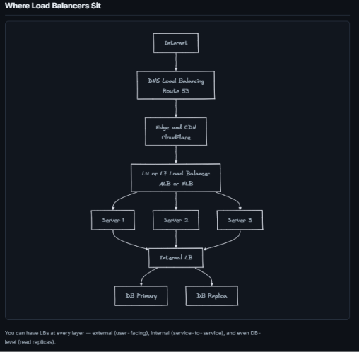

## Load Balancing
- A load balancer distributes incoming requests across multiple servers so no single server gets overwhelmed.
```
Without LB:
  All 10,000 users → Server 1 → crashes
With LB:
  10,000 users → Load Balancer → Server 1 (3,333 users)
                                → Server 2 (3,333 users)
                                → Server 3 (3,334 users)
```
## Why You Need It
- **High availability**: If one server dies, LB routes to healthy servers. Zero downtime.
- **Scalability**: Add more servers behind the LB when traffic grows.
- **Performance**: Spread load evenly so no server is a bottleneck.
- **Maintenance**: Take a server offline for updates without affecting users.


## Load Balancing Algorithms
1. Round Robin: Rotate through servers in order: 1 → 2 → 3 → 1 → 2 → 3 ...
    ```
    Request 1 → Server A
    Request 2 → Server B
    Request 3 → Server C
    Request 4 → Server A ...
    ```
   - **Pros**: Dead simple. Even distribution.
   - **Cons**: Doesn’t account for server capacity (Server with less CPU/RAM takes time to process if load increases) or current load. Server with a slow request still gets the next one.
   - **When to use**: All servers are identical and requests take similar time.
2. Weighted Round Robin: Same as Round Robin but stronger servers get more traffic.
    ```
    Server A (weight=5): gets 5 out of every 8 requests
    Server B (weight=2): gets 2 out of every 8 requests
    Server C (weight=1): gets 1 out of every 8 requests
    ```
   - **When to use**: Mixed hardware (some servers have more CPU/RAM).
3. Least Connections: Send to the server with fewest active connections right now.
    ```
    Server A: 45 active connections
    Server B: 12 active connections  ← next request goes here
    Server C: 67 active connections
    ```
   - **Pros**: Adapts to real-time load. Slow requests naturally get fewer new ones.
   - **Cons**: Slightly more overhead (must track connection counts).
   -  **When to use**: Requests have varying processing times (some fast, some slow).
4. Least Response Time: Send to the server with the fastest recent response time + fewest connections.
   - **When to use**: When latency matters more than pure load distribution.
5. IP Hash: Hash the client’s IP to determine which server to use. Same client always hits the same server.
    ```
    hash("192.168.1.1") % 3 = 0 → Server A (always)
    hash("10.0.0.5") % 3 = 2 → Server C (always)
    ```
   - **Pros**: Session persistence without sticky sessions. Good for caching (same user’s data stays on same server).
   -  **Cons**: Uneven if certain IPs send more traffic. Adding/removing servers changes all mappings.
   - **When to use**: When you need session affinity(sticky sessions / same ip to same server) without cookies.
6. Consistent Hashing: Advanced version of IP Hash that minimizes disruption when servers are added/removed. Only K/N keys need to be remapped (K = keys, N = nodes).
    - **When to use**: Distributed caches (Redis cluster), database sharding.
    - The Problem with Traditional Modulo Hashing
      - **The Formula:** `hash(key) % N` (where $N$ is the number of servers/nodes).
      - **The Failure Mode:** When a server is added or removed, $N$ changes. This causes nearly **all keys** to map to completely different servers, leading to massive cache misses, cache avalanches, or database stampedes.

    - What is Consistent Hashing?
      - Consistent hashing solves this by using a geometric concept called the **Hash Ring** so that adding or removing a node only requires re-mapping approximately $\frac{K}{N}$ keys (where $K$ is total keys and $N$ is total servers).
    - How the Hash Ring Works:
      1. **The Hash Space:** A hash function (e.g., MD5, MurmurHash) generates values across a continuous ring ranging from `0` to $2^{32}-1$.
      2. **Placing Servers:** Each server’s IP address or ID is passed through the hash function to place it at a specific coordinate on the ring.
      3. **Placing Keys (Data):** When a request or key comes in, it is hashed using the **exact same function** to land on a point on that same ring.
      4. **The Routing Rule:** Walk **clockwise** along the ring from the key's position until you encounter the first server. That server owns the data.
    - Adding or Removing Servers:
      - When a new server is added onto the ring, it occupies a space between two existing servers.
      - Only the keys that fall in the slice immediately preceding the new server's position are shifted to the new server.
      - All other keys across the rest of the ring remain completely unaffected.

    - The Hotspot Problem & Virtual Nodes (Vnodes)
      - **The Flaw:** If physical servers are placed randomly on the ring, they might clump up unevenly, causing one server to handle a massive chunk of the ring while others sit mostly idle (creating a **hotspot**).
      - **The Solution (Virtual Nodes):**
        - Instead of placing a physical server on the ring once, each physical server is represented by **multiple virtual replicas (vnodes)** scattered uniformly across the ring (e.g., `ServerA-1`, `ServerA-2`, `ServerA-3`).
        - **Why it works:** It chops up the hash space into many smaller, interleaved segments. Requests get evenly distributed across all physical servers, preventing any single server from becoming a bottleneck.

### L4 vs L7 Load Balancing
- **Layer 4 (Transport)**: Operates at the transport layer (TCP/UDP). Routes traffic based on IP address and port. Faster, but less flexible.
     - SSL (Secure Sockets Layer: browser and the server perform an SSL/TLS Handshake to encrypt web traffic like HTTP headers, URLs, or cookies. so hackers can't read the data passing through the internet, SSL termination means decrypting the encrypted HTTPS traffic at the load balancer (or server)) termination is not possible at L4. Cannot inspect HTTP headers or cookies (As decryption is not possible).
     - Example: AWS NLB, HAProxy TCP mode
        ```
         All traffic on port 443 → distribute to backend servers
         (Doesn't know if it's /api/users or /static/image.png)
        ```
- **Layer 7 (Application)**: Operates at the application layer (HTTP/HTTPS). Routes traffic based on content (URL, headers, cookies). Slower, but more flexible.
    - SSL termination is possible at L7. Can inspect HTTP headers and cookies.
    - Example: 	AWS ALB, Nginx, Envoy
   ```
   /api/* → API server pool
   /static/* → CDN/static server pool
   /ws/* → WebSocket server pool
   Host: admin.example.com → Admin servers
   ```

### Health Checks
- Load balancers periodically check the health of backend servers to ensure they can handle requests.
   ```
   LB → GET /health → Server responds 200 OK (every 10 seconds)
   LB → GET /health → Server responds 200 OK
   LB → GET /health → Server doesn't respond (timeout)
   LB → GET /health → Server doesn't respond (2nd miss)
   LB: "Server is dead" → stop sending traffic → alert
   ```
- **Types**: 
   - Active: LB periodically pings each server (most common)
   - Passive: LB monitors real traffic. If a server returns 5xx for N consecutive requests, mark it unhealthy.
- Health check endpoint should verify:
  - Server process is running 
  - Can connect to database 
  - Can connect to Redis 
  - Disk space is okay
```java
@GetMapping("/health")
public ResponseEntity<Map<String, String>> health() {
    Map<String, String> status = new HashMap<>();
    status.put("server", "UP");
    status.put("database", dbCheck() ? "UP" : "DOWN");
    status.put("redis", redisCheck() ? "UP" : "DOWN");

    boolean healthy = status.values().stream().allMatch(v -> v.equals("UP"));
    return ResponseEntity.status(healthy ? 200 : 503).body(status);
}
```

### Sticky Sessions (Session Affinity):
- Problem: User logs into Server A (session stored in Server A’s memory). Next request goes to Server B → session not found → user is logged out.
- Solutions:
  - External session store (Redis):
    - How: Store sessions in shared Redis
    - Pros: Stateless servers, best approach
    - Cons: Extra infra (Redis cluster), network latency
  - Sticky sessions (cookie-based):
    - LB routes same user to same server
    - Pros: Simple
    - Cons: If server dies, session is lost. Not scalable (if one server has too many users, it becomes a hotspot).
  - JWT tokens:
    - How: Store session info in JWT token (signed, encrypted) → sent with every request
    - Pros: Stateless servers, no extra infra
    - Cons: Token size (if storing too much info), security (if token is stolen, attacker can impersonate user until it expires).
- **Best practice**: Store sessions in Redis. Servers are stateless. LB uses any algorithm without worrying about session affinity.

### Load Balancing at Scale
- Single LB is a single point of failure.
- Solutions:
  - Active-Passive: Two LBs. Primary handles all traffic. If it dies, passive takes over (via floating IP/DNS failover).
  - Active-Active: Both LBs handle traffic (DNS returns both IPs). If one dies, the other handles all.
  - DNS Load Balancing: Multiple LB IPs in DNS. Client picks one. Coarse-grained but simple.
   ```
   DNS returns: LB1 (52.1.1.1), LB2 (52.1.1.2)
   Client A resolves to LB1 → routes to backend
   Client B resolves to LB2 → routes to backend
   LB1 dies → DNS health check removes it → all clients go to LB2
   ```