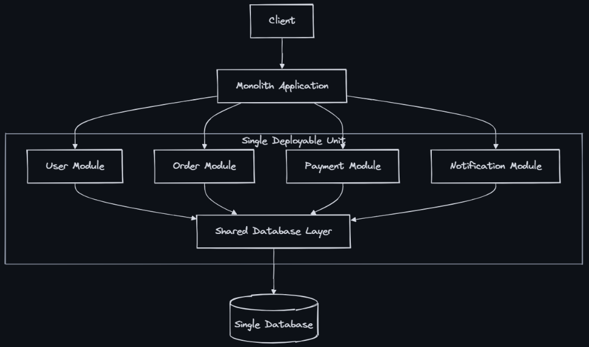
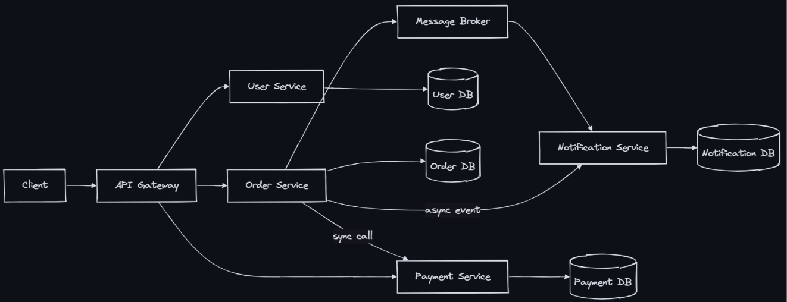
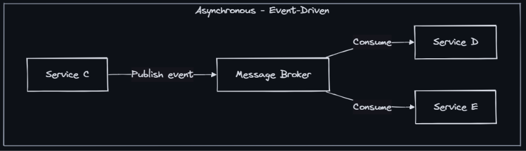

### Microservices vs Monolith
- Microservices is an architectural style where an application is composed of small, independently deployable services, each owning its own data and communicating over the network. A monolith is a single deployable unit containing all functionality.

### Monolith Architecture

- The monolith-first approach (recommended by Martin Fowler): Start monolithic, identify service boundaries as the system matures, then extract services where the pain is greatest.

### Microservices Architecture

### Decomposition Strategies
- By business capability: One service per business function - User, Order, Payment, Inventory
- By subdomain (DDD) - Bounded contexts from Domain-Driven Design - Core domain vs supporting vs generic
- By data ownership - Who owns this data? That’s a service - User Profile Service owns user table
- Strangler fig - Gradually replace monolith pieces - Route new features to microservice, old features stay

### Inter-Service Communication

- REST (sync) - Simple CRUD, client needs immediate response - Coupling, cascading failures
- gRPC (sync) - Internal service-to-service, performance critical - Strong contracts, requires proto management

- Events (async) - Decoupled notifications, eventual consistency OK	- Harder to debug, eventual consistency
- Command queue (async) - Work that can be deferred, retry needed - Latency, complexity

### Challenges of Microservices
- Distributed tracing - OpenTelemetry, Jaeger — propagate trace IDs across services
- Distributed transactions - Saga pattern (choreography or orchestration)
- Service discovery - Consul, Eureka, Kubernetes DNS
- Configuration - Centralized config server (Spring Cloud Config, Consul KV)
- Testing - Contract testing (Pact), integration test environments
- Deployment - CI/CD per service, container orchestration (Kubernetes)
- Debugging - Centralized logging (ELK), distributed tracing
- Network reliability - Circuit breakers, retries, timeouts, service mesh
- Data consistency - Outbox pattern, CDC, eventual consistency

### Service Mesh
- A service mesh (Istio, Linkerd) handles cross-cutting concerns at the infrastructure level:
    - mTLS between services (encryption)
    - Circuit breaking and retries
    - Traffic routing and canary deployments
    - Observability (metrics, traces, logs)
- All without changing application code — the sidecar proxy handles it.

