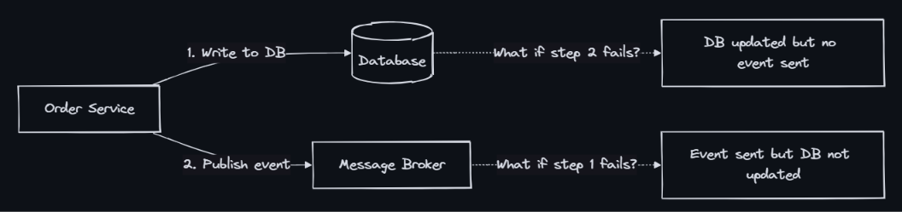
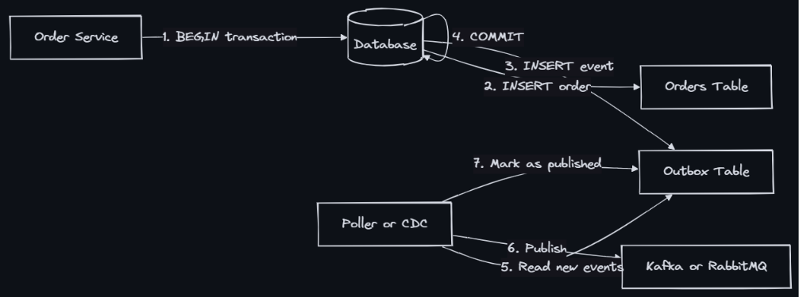
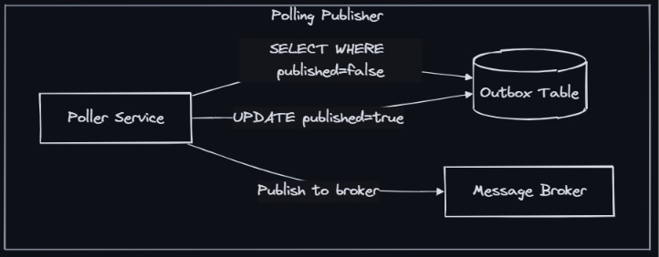

### Outbox Pattern
- The Outbox Pattern ensures that a database write and an event publication happen atomically — either both succeed or neither does. It solves the “dual-write problem” by writing the event to an outbox table in the same database transaction as the business data, then a separate process publishes those events to the message broker.

- **The Dual-Write Problem**: When a service needs to update its database AND publish an event, naive approaches fail:

    - DB write succeeds, event publish fails  - Downstream services never learn about the change
    - Event publish succeeds, DB write fails - Downstream services act on phantom data
    - Service crashes between the two operations - Inconsistency depending on which completed
    - You cannot make two independent systems (DB + broker) transactional without a coordination pattern.

### How the Outbox Pattern Works

- Step-by-step:
  1. Service begins a database transaction
  2. Writes business data (e.g., insert order)
  3. Writes event to the outbox table in the SAME transaction
  4. Commits the transaction — atomicity guaranteed by the DB
  5. A separate process (poller or CDC connector) reads unpublished events
  6. Publishes events to the message broker
  7. Marks events as published (or deletes them)

### Outbox Table Schema
```
CREATE TABLE outbox (
    id            UUID PRIMARY KEY,
    aggregate_type VARCHAR(255),    -- e.g., "Order", "Payment"
    aggregate_id   VARCHAR(255),    -- e.g., order ID
    event_type    VARCHAR(255),     -- e.g., "OrderCreated"
    payload       JSONB,           -- event data
    created_at    TIMESTAMP,       -- for ordering
    published     BOOLEAN DEFAULT FALSE
);
```

### Two Approaches: Polling vs CDC

- Polling Publisher:
    - How it works: Periodically queries outbox table
    - Latency: Polling interval (100ms - 5s)
    - DB load: Adds read queries to DB
    - Complexity: Simple to implement
    - Ordering: Must handle carefully
    - Scalability: Limited by polling frequency
    - Best for: Low-medium throughput

- CDC(Change Data Capture)-Based (Debezium): A service like Debezium (running on Kafka Connect or as a standalone container). It connects to the database via its native replication protocol, reads the WAL/Redo logs in real-time, translates row changes into JSON/Avro events, and publishes them.
    - Reads database transaction log (Write-Ahead Log(WAL)/Binary Log(binlog))
    - Near real-time (sub-second)
    - Zero additional DB queries
    - Requires CDC infrastructure
    - Preserves commit order
    - Scales with DB throughput
    - High throughput, low latency

### Exactly-Once Publishing
- The outbox pattern guarantees at-least-once delivery. For exactly-once semantics:
    - Idempotent consumers: Consumers deduplicate using event ID
    - Idempotency key in event: Include unique ID; consumer checks before processing
    - Transactional outbox + dedup table: Consumer writes to its own dedup table in same transaction

### Comparison with Alternatives
| Pattern | Atomicity | Complexity | Performance | Use Case |
|---|---|---|---|---|
| Outbox (Polling) | Strong | Low | Good | Most services |
| Outbox (CDC) | Strong | Medium | Excellent | High-throughput systems |
| Event Sourcing | Strong | High | Excellent | When full audit trail is needed |
| 2PC (Two-Phase Commit) | Strong | High | Poor | Legacy systems only |
| Saga (Choreography) | Eventual | Medium | Good | Multi-service workflows |
| Best-effort + reconciliation | Weak | Low | Excellent | Non-critical events |
