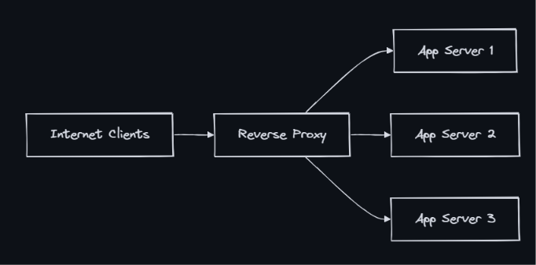

### Proxy
- A proxy is an intermediary server that sits between a client and a destination server, forwarding requests on behalf of one side. It can modify, filter, cache, or log traffic passing through it.

### Forward Proxy (Client-Side)
- A forward proxy sits in front of clients and forwards their requests to the internet. The destination server sees the proxy’s IP, not the client’s.

- Use cases:
  - Corporate filtering: Block access to certain websites
  - Anonymity: Hide client IP from destination
  - Caching: Cache frequently accessed content (reduce bandwidth)
  - Access control: Require authentication before internet access
  - Geo-bypass: Access content restricted to other regions (VPN)
  - Logging: Monitor all outbound traffic from an organization
- Examples: Squid proxy, corporate firewalls, VPN services, Tor network

### Reverse Proxy (Server-Side)
- A reverse proxy sits in front of servers and handles incoming requests from the internet. Clients see the proxy’s address, not the actual server’s.

- Use cases:
  - Load balancing: Distribute requests across backend servers
  - SSL termination: Handle TLS encryption/decryption at the proxy
  - Caching: Cache static assets and API responses
  - Compression: Gzip responses before sending to client
  - Security: Hide backend topology, WAF, DDoS protection
  - A/B testing: Route percentage of traffic to different backends
  - Canary deployments: Send 5% traffic to new version
- Examples: Nginx, HAProxy, Cloudflare, AWS ALB, Apache httpd

### Transparent Proxy
- A transparent proxy intercepts traffic without the client’s knowledge or configuration. The client doesn’t know a proxy exists.

- Use cases:
  - ISP caching (intercepting HTTP to serve cached content)
  - Corporate content filtering without client configuration
  - CDN edge caching (intercepting DNS to route to nearest PoP)
  - Government censorship (intercepting and blocking specific domains)
- Limitation: Doesn’t work well with HTTPS (can’t inspect encrypted traffic without MITM certificate)

### Sidecar Proxy (Service Mesh)
- A sidecar proxy runs alongside every service instance, handling all inbound and outbound network traffic transparently. The application communicates with localhost; the sidecar handles service discovery, TLS, retries, and observability.
.png)
- Envoy proxy features:
  - L7 load balancing (HTTP/2, gRPC native)
  - Automatic retries with circuit breaking
  - mTLS between all services (zero-trust) (encryption and token validation are offloaded entirely from your application code)
  - Distributed tracing headers propagation
  - Rate limiting (local and global)
  - Hot restarts (update config without dropping connections)
- Used by: Istio (Envoy sidecar), Linkerd (linkerd-proxy), Consul Connect (Envoy)

### Nginx as Reverse Proxy
- Nginx is the most popular reverse proxy for web applications.

### Real-World Architectures
- Netflix: Zuul (edge gateway) + Envoy (internal mesh)
- Uber: Nginx (edge) + custom sidecar proxies
- Cloudflare: Global reverse proxy + CDN + WAF + DDoS

