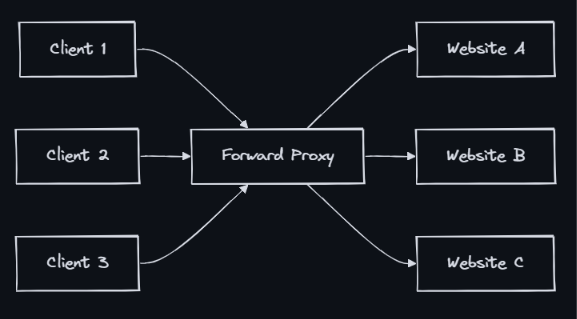

### Proxy
- A proxy is an intermediary server that sits between a client and a destination server, forwarding requests on behalf of one side. It can modify, filter, cache, or log traffic passing through it.

### Forward Proxy (Client-Side)
- A forward proxy sits in front of clients and forwards their requests to the internet. The destination server sees the proxy’s IP, not the client’s.
