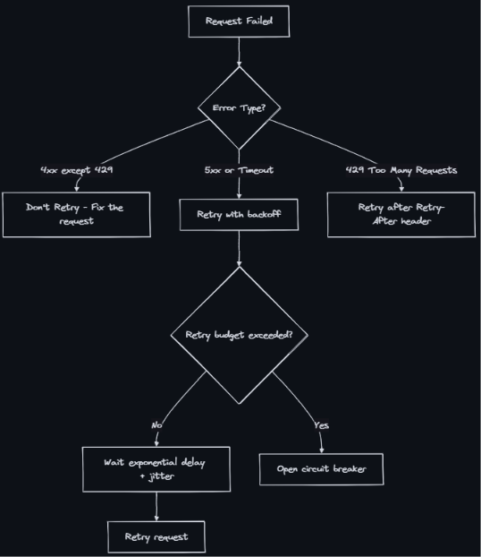
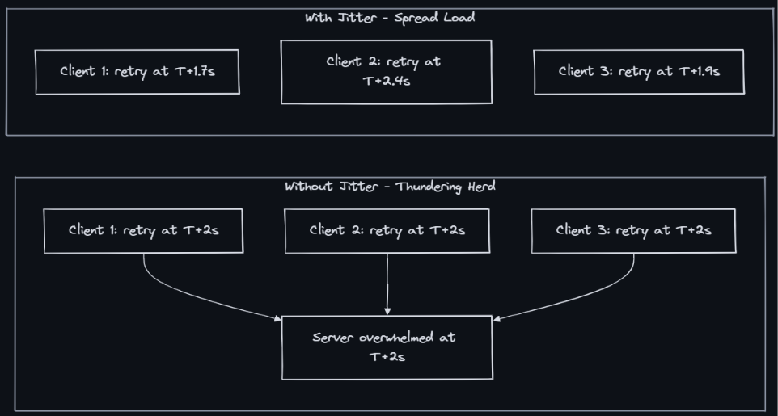
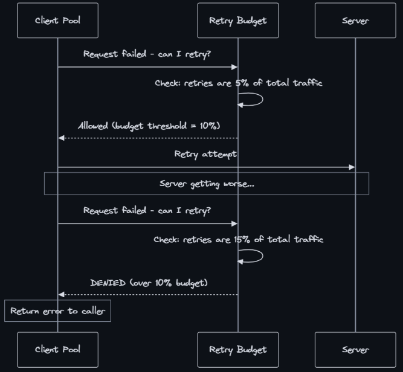
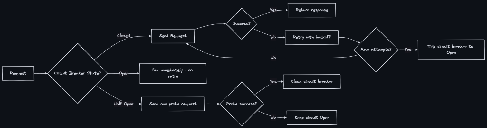

### Retry and Exponential Backoff
- A retry strategy where failed operations are retried with increasing delays between attempts. Each subsequent delay is typically double the previous one, preventing a failing system from being overwhelmed by immediate retries.

### Transient vs Permanent Failures
- The first rule of retries: only retry transient failures.
- Transient: Network timeout, 503, connection reset, rate limited (429) - should retry
- Permanent: 400 Bad Request, 401 Unauthorized, 404 Not Found - Don't retry
- Ambiguous: 500 Internal Server Error, timeout (did it succeed?) - Maybe retry (with idempotency)


### Exponential Backoff Formula
```
delay = min(base_delay * 2^attempt, max_delay)
```
- Cap the delay: Without a max_delay, attempt 20 would wait 12+ days. Typical max: 30-60 seconds.

### Why Jitter Matters
- Without jitter, all clients that failed at the same time retry at the same time (correlated retries). This causes thundering herd — the server gets hit by a wave of retries simultaneously.

- Jitter Strategies
    - Full jitter - ```random(0, base * 2^attempt)``` - Maximum spread, lowest avg delay
    - Equal jitter - ```base * 2^attempt / 2 + random(0, base * 2^attempt / 2)``` - Guaranteed minimum wait
    - Decorrelated jitter - ```min(max_delay, random(base, prev_delay * 3))``` - AWS recommended; good spread
- AWS recommendation: Decorrelated jitter performs best in practice. Full jitter is simplest and nearly as effective.

### Retry Budget
- A retry budget limits the total percentage of traffic that can be retried. This prevents cascading failures where retries amplify load.

- Per-client budget - Each client limits its own retry rate (e.g., max 3 retries per request)
- Global budget - Total retry traffic across all clients capped at X% (e.g., 10% of total QPS)
- Token bucket - Retries consume tokens; tokens replenish at a fixed rate

- Google SRE recommendation: Retry budget of 10% — if more than 10% of your requests are retries, stop retrying and let the circuit breaker open.

### Circuit Breaker Integration
- Retries and circuit breakers work together:

- Flow:
  1. Normal: retries handle transient failures 
  2. Persistent failures: circuit breaker opens after N consecutive failures 
  3. Open circuit: all requests fail immediately (no retries, no load on downstream)
  4. Half-open: periodic probe to check recovery 
  5. Recovered: circuit closes, retries resume normally

### Real-World Implementations
- AWS SDK - Exponential backoff + full jitter; max 3 attempts default
- gRPC - Configurable retry policy in service config; supports hedging
- Kafka producer - retries config + retry.backoff.ms; idempotent producer prevents duplicates
- Spring Retry	@Retryable annotation with configurable backoff

### Hedged Requests (Advanced)
- Instead of waiting for a timeout to retry, send the request to multiple backends simultaneously and take the first response.
- Standard retry 
  - Trigger: After complete failure or timeout.
  - Action: The first attempt crashed or timed out completely. You try again. (Slow).
- Hedged Request (Proactive/Percentile-based):
  - Trigger: After P95 (95% of all your users got their response faster than x milliseconds. Only the unluckiest 5% had to wait longer than x ms. Those slow requests (the 5% or 1% at the tail end) are called Tail Latency. They happen because a server got hit by a sudden garbage collection pause, a noisy neighbor, or a disk hiccup.) latency is exceeded.
  - Action: The first attempt hasn't failed yet, it's just taking longer than usual. You hedge your bets by sending a duplicate.
- Speculative Retry (Proactive/Fixed-delay):
  - Trigger: After a short, fixed delay (e.g., exactly 10 milliseconds).
  - Action: Unlike Hedged requests (which wait for a statistical threshold like P95), speculative retries are built for ultra-fast read operations (like reading from database replicas). You say: "Send the read to Replica 1. If it doesn't reply in 10ms, speculatively fire it to Replica 2 right away."


