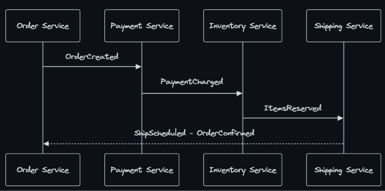
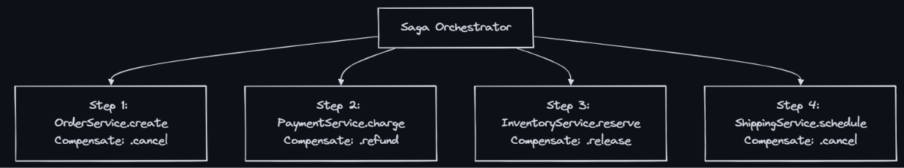
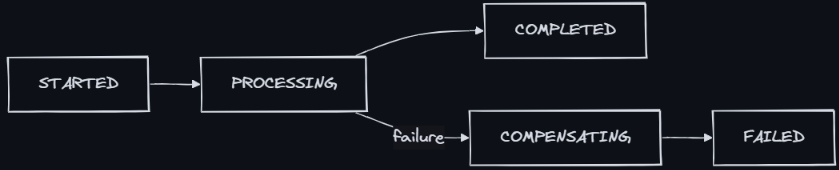

### Saga Pattern
- A Saga is a sequence of local transactions across multiple services, where each step either succeeds and triggers the next, or fails and triggers compensating (undo) actions for all previous steps.
    ```
    Traditional (single DB transaction):
      BEGIN TRANSACTION
        debit account A
        credit account B
        update ledger
      COMMIT  ← all or nothing, easy!
    
    Distributed (microservices, no shared DB):
      Service A: debit account    ← has its own DB
      Service B: credit account   ← has its own DB
      Service C: update ledger    ← has its own DB
    
      Problem: Can't wrap all 3 in one transaction!
      What if Service B succeeds but Service C fails?
    ```
  
### The Distributed Transaction Problem
- In a monolith, ACID transactions are easy. In microservices, each service has its own database. You can’t use a single transaction across services.
- Why 2PC (Two-Phase Commit) doesn’t work at scale:
    - Coordinator is a single point of failure
    - All participants are BLOCKED during prepare phase
    - Latency: 2 network round trips minimum
    - Any participant failure = entire transaction blocked
    - Doesn’t work across different DB vendors
    - Not supported by most message queues or HTTP services
- Saga is the alternative for microservices.

### How Sagas Work
- Forward Flow (Happy Path):
    ```
    Order Placement Saga:
    
    Step 1: Order Service    → Create order (PENDING)
    Step 2: Payment Service  → Charge customer
    Step 3: Inventory Service → Reserve items
    Step 4: Shipping Service → Schedule delivery
    Step 5: Order Service    → Mark order CONFIRMED
    
    All succeeded? Great! Order is complete.
    ```
- Compensating Flow (Failure)
    ```
    Step 1: Order Service    → Create order (PENDING)     ✓
    Step 2: Payment Service  → Charge customer            ✓
    Step 3: Inventory Service → Reserve items             ✗ FAILED! (out of stock)
    
    Compensating transactions (reverse order):
    Step 2C: Payment Service → Refund customer            ✓ (undo step 2)
    Step 1C: Order Service   → Cancel order (CANCELLED)   ✓ (undo step 1)
    
    Result: System is back to consistent state. No money lost.
    ```

### Choreography (Event-Driven)
- Each service listens for events and decides what to do next. No central coordinator.

- Each service:
    - Listens for specific events on message bus
    - Performs its local transaction
    - Publishes result event (success or failure)
    - Other services react to the event
- Choreography - Failure Flow
    ```
    OrderCreated → Payment charges → PaymentCharged → Inventory tries to reserve
                                                      → FAILS! Publishes "ReservationFailed"
    
    Payment hears "ReservationFailed" → refunds → publishes "PaymentRefunded"
    Order hears "PaymentRefunded" → cancels order → publishes "OrderCancelled"
    ```

### Orchestration (Coordinator)
- A central Saga Orchestrator tells each service what to do and handles failures.

    ```
    Orchestrator flow:
      1. Orchestrator → OrderService: "Create order" → OK
      2. Orchestrator → PaymentService: "Charge $50" → OK
      3. Orchestrator → InventoryService: "Reserve items" → FAILED!
      4. Orchestrator detects failure, runs compensations:
         - Orchestrator → PaymentService: "Refund $50" → OK
         - Orchestrator → OrderService: "Cancel order" → OK
      5. Orchestrator marks saga as FAILED
    ```

### Compensating Transactions
- The “undo” operation for each step. Not always a simple reverse:
    ```
    ┌─────────────────────┬────────────────────────────────────────┐
    │ Forward Action       │ Compensating Action                    │
    ├─────────────────────┼────────────────────────────────────────┤
    │ Create order         │ Cancel order                           │
    │ Charge payment       │ Refund payment                        │
    │ Reserve inventory    │ Release inventory                     │
    │ Send notification    │ Send "sorry, cancelled" notification  │
    │ Book hotel           │ Cancel booking (may lose deposit!)    │
    │ Debit account        │ Credit account                        │
    └─────────────────────┴────────────────────────────────────────┘
    ```
- Important: Compensations are not always perfect inverses:
    - Some actions can’t be fully undone (email already sent)
    - Some have costs (cancellation fees)
    - Some require human intervention (physical shipment already sent)
- Saga States


### Implementation Example: Order Saga (Orchestration)
```java
import java.util.ArrayList;
import java.util.List;

@FunctionalInterface
interface SagaOperation {
    void execute(OrderData orderData) throws Exception;
}

class SagaStep {
    final SagaOperation action;
    final SagaOperation compensation;

    SagaStep(SagaOperation action, SagaOperation compensation) {
        this.action = action;
        this.compensation = compensation;
    }
}

class OrderSaga {
    private final List<SagaStep> steps;

    OrderSaga(
            OrderService orderService,
            PaymentService paymentService,
            InventoryService inventoryService,
            ShippingService shippingService) {
        steps = List.of(
            new SagaStep(orderService::createOrder, orderService::cancelOrder),
            new SagaStep(paymentService::charge, paymentService::refund),
            new SagaStep(inventoryService::reserve, inventoryService::release),
            new SagaStep(shippingService::schedule, shippingService::cancel)
        );
    }

    SagaCompleted execute(OrderData orderData) {
        List<SagaStep> completedSteps = new ArrayList<>();

        for (SagaStep step : steps) {
            try {
                step.action.execute(orderData);
                completedSteps.add(step);
            } catch (Exception e) {
                // Run compensations in reverse order.
                for (int i = completedSteps.size() - 1; i >= 0; i--) {
                    completedSteps.get(i).compensation.execute(orderData);
                }
                throw new SagaFailed(e);
            }
        }

        return new SagaCompleted(orderData);
    }
}

class SagaFailed extends RuntimeException {
    SagaFailed(Throwable cause) {
        super(cause);
    }
}

class SagaCompleted {
    final OrderData orderData;

    SagaCompleted(OrderData orderData) {
        this.orderData = orderData;
    }
}
```

### When to Use / When NOT to Use
- Use Saga Pattern When:
    - Multiple microservices must coordinate a business transaction
    - Each service has its own database (no shared DB)
    - You need eventual consistency across services
    - Operations are long-running (can’t hold DB locks)
    - You need audit trail of what happened in each step
- When NOT to Use:
    - Single database — use regular ACID transactions
    - Strong consistency required immediately — saga is eventually consistent
    - Simple operations — 2 services only, consider direct call + retry
    - Read-only operations — no transaction needed
    - When compensations are impossible — some actions truly can’t be undone

### Real-World Examples
- Amazon	Order fulfillment: payment → inventory → warehouse pick → ship. Cancellation triggers compensating actions.
- Netflix	Uses Conductor (orchestration engine) for multi-service workflows like content ingestion and encoding.
