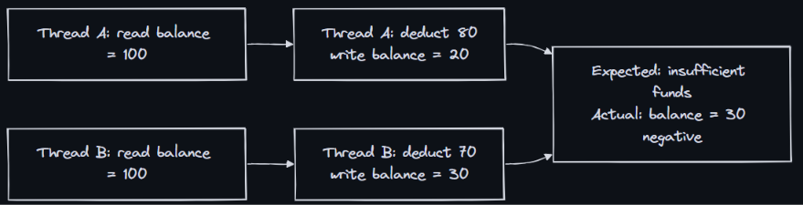

### Concurrency in LLD

- Concurrency shows up in LLD when multiple threads or requests access shared state simultaneously. A parking lot with 10 entry gates, a rate limiter handling 1000 requests/second, or a task scheduler with worker threads – all need synchronization to avoid corrupted state.

### The Core Problem: Race Conditions

- Both threads read the same balance, both decide they can proceed, both write. The account goes negative. This is a check-then-act race condition.

### Synchronization Primitives

```java
// 1. Mutex (synchronized / ReentrantLock)
// Use when: exclusive access to shared mutable state
public class Wallet {
    private final Lock lock = new ReentrantLock();
    private long balanceCents;

    public void debit(long amountCents) {
        lock.lock();
        try {
            if (balanceCents < amountCents) {
                throw new InsufficientBalanceException(balanceCents, amountCents);
            }
            balanceCents -= amountCents;
        } finally {
            lock.unlock(); // ALWAYS in finally
        }
    }

    public void credit(long amountCents) {
        lock.lock();
        try {
            balanceCents += amountCents;
        } finally {
            lock.unlock();
        }
    }

    public long getBalance() {
        lock.lock();
        try {
            return balanceCents;
        } finally {
            lock.unlock();
        }
    }
}

// 2. ReadWriteLock
// Use when: many readers, few writers
public class ParkingLot {
    private final ReadWriteLock rwLock = new ReentrantReadWriteLock();
    private final List<Floor> floors;

    public int getAvailableSlots(VehicleType type) {
        rwLock.readLock().lock(); // Multiple threads can read simultaneously
        try {
            return floors.stream()
                .mapToInt(f -> f.countAvailable(type))
                .sum();
        } finally {
            rwLock.readLock().unlock();
        }
    }

    public Ticket park(Vehicle vehicle) {
        rwLock.writeLock().lock(); // Exclusive access for writes
        try {
            Slot slot = strategy.findSlot(floors, vehicle.getType());
            if (slot == null) throw new ParkingFullException();
            slot.occupy(vehicle);
            return new Ticket(vehicle, slot, Instant.now());
        } finally {
            rwLock.writeLock().unlock();
        }
    }
}

// 3. Atomic variables
// Use when: single variable needs atomic updates (counters, flags)
public class RateLimiter {
    private final AtomicInteger requestCount = new AtomicInteger(0);
    private final AtomicLong windowStart = new AtomicLong(System.currentTimeMillis());
    private final int maxRequests;
    private final long windowMillis;

    public boolean allowRequest() {
        long now = System.currentTimeMillis();
        long start = windowStart.get();
        if (now - start > windowMillis) {
            // New window -- reset
            if (windowStart.compareAndSet(start, now)) {
                requestCount.set(1);
                return true;
            }
        }
        return requestCount.incrementAndGet() <= maxRequests;
    }
}
```

### Thread Pool Pattern

- Thread pools reuse a fixed number of threads to process tasks, avoiding the overhead of creating/destroying threads for each request.

    ```java
    public class TaskScheduler {
        private final ExecutorService executor;
        private final BlockingQueue<ScheduledTask> taskQueue;
        private final Map<String, Future<?>> runningTasks = new ConcurrentHashMap<>();
    
        public TaskScheduler(int poolSize) {
            this.executor = Executors.newFixedThreadPool(poolSize);
            this.taskQueue = new LinkedBlockingQueue<>();
        }
    
        public String submit(Runnable task, String name) {
            String taskId = UUID.randomUUID().toString();
            // Build the task first, register it, THEN hand it to the pool.
            // Submitting before registering lets a fast task finish and run its
            // remove() on an absent key, leaving an entry nothing ever cleans up.
            FutureTask<Void> future = new FutureTask<>(() -> {
                try {
                    task.run();
                } catch (Exception e) {
                    // Log failure, update task status
                } finally {
                    runningTasks.remove(taskId);
                }
                return null;
            });
            runningTasks.put(taskId, future);
            executor.execute(future);
            return taskId;
        }
    
        public boolean cancel(String taskId) {
            Future<?> future = runningTasks.get(taskId);
            if (future != null) {
                return future.cancel(true);
            }
            return false;
        }
    
        public void shutdown() {
            executor.shutdown();
            try {
                if (!executor.awaitTermination(30, TimeUnit.SECONDS)) {
                    executor.shutdownNow();
                }
            } catch (InterruptedException e) {
                executor.shutdownNow();
            }
        }
    }
    ```
  
### When to Use vs When to Avoid

- Mutex/Lock:
  - Use: Protecting shared mutable state
  - Avoid: Read-heavy workloads (use RWLock)
- ReadWriteLock:
  - Use: Many readers, few writers
  - Avoid: Write-heavy (adds overhead vs plain mutex)
- Atomic variables:
  - Use: Single counters or flags
  - Avoid: Complex multi-field updates
- Thread pool:
  - Use: Many short-lived tasks
  - Avoid: Few long-running tasks (dedicated threads better)
- ConcurrentHashMap:
  - Use: Shared map with concurrent access	
  - Avoid: Single-threaded context

