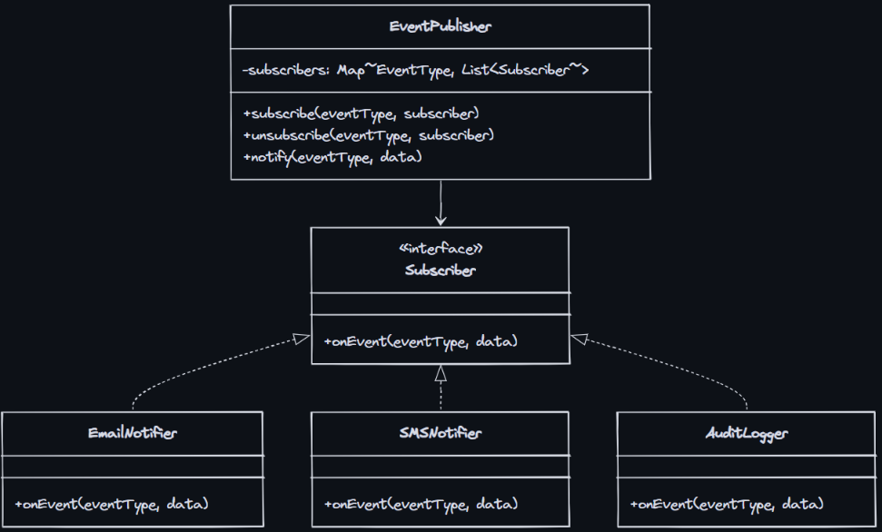

### Observer Pattern

- The Observer pattern defines a one-to-many dependency between objects so that when one object (the subject/publisher) changes state, all its dependents (observers/subscribers) are notified and updated automatically. The publisher doesn’t know or care who is listening.

### Class Diagram


### Real-World Example: Payment Wallet Notifications

- When a wallet transaction completes, multiple systems need to react: send a receipt, update the dashboard, log for auditing, trigger fraud checks. The wallet shouldn’t know about all these systems. 
    ```java
    // Event types
    public enum WalletEvent {
        MONEY_ADDED, MONEY_DEDUCTED, TRANSFER_COMPLETED, LOW_BALANCE
    }
    
    // Subscriber interface
    public interface WalletEventListener {
        void onEvent(WalletEvent event, Transaction transaction);
    }
    
    // Event publisher (reusable component)
    public class EventBus {
        private final Map<WalletEvent, List<WalletEventListener>> listeners = new EnumMap<>(WalletEvent.class);
    
        public void subscribe(WalletEvent event, WalletEventListener listener) {
            listeners.computeIfAbsent(event, k -> new ArrayList<>()).add(listener);
        }
    
        public void unsubscribe(WalletEvent event, WalletEventListener listener) {
            List<WalletEventListener> subs = listeners.get(event);
            if (subs != null) subs.remove(listener);
        }
    
        public void publish(WalletEvent event, Transaction transaction) {
            List<WalletEventListener> subs = listeners.getOrDefault(event, Collections.emptyList());
            for (WalletEventListener listener : subs) {
                listener.onEvent(event, transaction);
            }
        }
    }
    
    // Concrete listeners
    public class ReceiptEmailer implements WalletEventListener {
        @Override
        public void onEvent(WalletEvent event, Transaction txn) {
            String subject = switch (event) {
                case MONEY_ADDED -> "Money added to wallet";
                case MONEY_DEDUCTED -> "Payment processed";
                case TRANSFER_COMPLETED -> "Transfer successful";
                default -> "Wallet update";
            };
            emailService.send(txn.getUserEmail(), subject, buildReceiptBody(txn));
        }
    }
    
    public class FraudDetector implements WalletEventListener {
        @Override
        public void onEvent(WalletEvent event, Transaction txn) {
            if (txn.getAmount() > THRESHOLD || isUnusualLocation(txn)) {
                flagForReview(txn);
            }
        }
    }
    
    public class BalanceAlertService implements WalletEventListener {
        @Override
        public void onEvent(WalletEvent event, Transaction txn) {
            if (event == WalletEvent.MONEY_DEDUCTED && txn.getRemainingBalance() < MIN_BALANCE) {
                pushNotification(txn.getUserId(), "Low balance alert");
            }
        }
    }
    
    // Usage: Wallet publishes events, doesn't know who listens
    public class Wallet {
        private final EventBus eventBus;
        private double balance;
    
        public Wallet(EventBus eventBus, double initialBalance) {
            this.eventBus = eventBus;
            this.balance = initialBalance;
        }
    
        public void addMoney(double amount, String source) {
            balance += amount;
            Transaction txn = new Transaction(amount, source, balance);
            eventBus.publish(WalletEvent.MONEY_ADDED, txn);
        }
    
        public void deduct(double amount, String merchant) {
            if (balance < amount) throw new InsufficientBalanceException();
            balance -= amount;
            Transaction txn = new Transaction(amount, merchant, balance);
            eventBus.publish(WalletEvent.MONEY_DEDUCTED, txn);
        }
    }
    ```
  
### Push vs Pull Models

- Push
  - How It Works: Publisher sends full event data to observers
  - Use When: Observers always need the data; avoids extra calls
- Pull
  - How It Works: Publisher notifies; observers query for what they need
  - Use When: Different observers need different subsets of data
- The code above uses the push model (transaction data sent with the event). For pull, you’d pass a reference to the subject and let observers call getters.

### Handling Slow Observers

- If one observer is slow (e.g., sending emails), it blocks subsequent observers. Solutions:
  1. Async dispatch – Publish events to a queue; observers process independently
  2. Thread pool – Each observer gets its own thread
  3. Timeout + skip – If observer doesn’t respond in N ms, skip it
- In a machine coding round, synchronous dispatch is usually fine. Mention async as an improvement.

### When to Use vs When to Avoid

- Use Observer When:
  - Multiple components react to the same event
  - Publisher shouldn’t know about specific listeners
  - New listeners will be added over time
  - Event-driven requirements: “notify when…”
  - You need to decouple modules
- Avoid When:
  - Only one component needs to react (direct method call is simpler)
  - The dependency is obvious and fixed
  - The listener set is static and small
  - Simple request-response flow
  - Tight coupling is acceptable (same team, same module)

