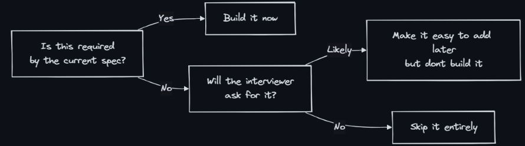

### Over-Engineering in LLD
- Over-engineering means adding complexity that doesn’t solve a current problem. In machine coding rounds, this kills you: you spend 30 minutes building an elaborate plugin system when a simple if-else would have worked, and you never finish the core functionality.

### YAGNI: You Aren’t Gonna Need It

- The principle: don’t build functionality until you actually need it. “We might need this later” is not a reason to build it now – especially in a 90-minute interview.

### Real Examples of Over-Engineering in Interviews

1. Pattern for One Implementation
    ```java
    // OVER-ENGINEERED: Factory + Strategy + Builder for a single pricing rule
    public interface PricingStrategyFactory {
        PricingStrategy create(PricingConfig config);
    }
    
    public class DefaultPricingStrategyFactory implements PricingStrategyFactory {
        @Override
        public PricingStrategy create(PricingConfig config) {
            return new HourlyPricingStrategy(config.getRate());
        }
    }
    
    public interface PricingStrategy {
        Money calculate(Duration duration, VehicleType type);
    }
    
    public class HourlyPricingStrategy implements PricingStrategy {
        // ... the only implementation that exists
    }
    
    // JUST RIGHT: Direct implementation. Add abstraction when you need a second variant.
    public class PricingService {
        private final Map<VehicleType, Integer> hourlyRates;
    
        public PricingService(Map<VehicleType, Integer> hourlyRates) {
            this.hourlyRates = hourlyRates;
        }
    
        public Money calculate(VehicleType type, Duration duration) {
            int rate = hourlyRates.getOrDefault(type, 10);
            long hours = Math.max(1, duration.toHours()); // minimum 1 hour
            return Money.of(rate * hours);
        }
    }
    // If interviewer says "add tiered pricing," THEN extract the interface.
    ```

2. Generic Framework When You Need Specific Logic
    ```java
    // OVER-ENGINEERED: Generic event system for a simple notification
    public class EventBus<T extends Event> {
        private final Map<Class<? extends Event>, List<EventHandler<? extends Event>>> handlers;
        // ... 50 lines of generic event infrastructure
    }
    
    // When all you needed was:
    public class ParkingLot {
        private final NotificationService notifications;
        
        public Receipt unpark(Ticket ticket) {
            // ... unpark logic ...
            notifications.sendReceipt(ticket.getVehicle().getOwnerPhone(), receipt);
            return receipt;
        }
    }
    ```

3. Premature Thread Safety
    ```java
    // OVER-ENGINEERED: ConcurrentHashMap, locks, AtomicInteger everywhere
    // when the problem statement says "single-user CLI application"
    public class VendingMachine {
        private final AtomicInteger balance = new AtomicInteger(0);
        private final ConcurrentHashMap<String, Product> inventory = new ConcurrentHashMap<>();
        private final ReentrantReadWriteLock stateLock = new ReentrantReadWriteLock();
        // ... way more complex than needed for a single-threaded demo
    }
    
    // JUST RIGHT for single-threaded:
    public class VendingMachine {
        private int balance = 0;
        private final Map<String, Product> inventory = new HashMap<>();
        // Simple, readable, works for the demo
        // Mention thread safety as an improvement if asked
    }
    ```
   
### The Rule of Three
- Don’t abstract until you have three instances of the same pattern:
  1. First occurrence: Write it directly. No abstraction.
  2. Second occurrence: Note the duplication, maybe extract a method. Still no pattern.
  3. Third occurrence: NOW introduce the pattern. You have enough examples to design a good abstraction.
