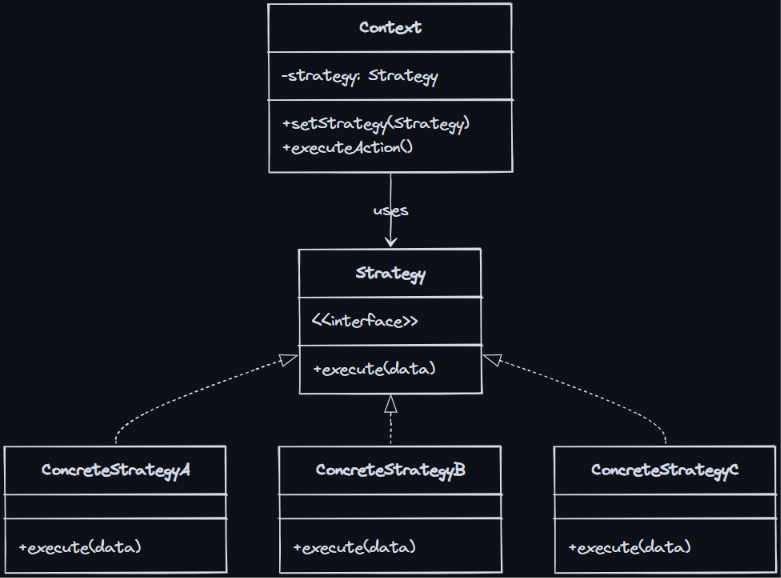

### Strategy Pattern
- The Strategy pattern defines a family of algorithms, encapsulates each one in its own class, and makes them interchangeable at runtime. The client picks which strategy to use without knowing the algorithm’s internals.

### Class Diagram


### The Problem: Growing If-Else Chains
- Every time someone adds a new algorithm variant, the existing class gets another branch. This violates OCP, makes testing harder, and creates merge conflicts when multiple developers add variants simultaneously.
    ```java
    // Before: every new rate-limiting algorithm modifies this class
    public class RateLimiter {
        public boolean allowRequest(String clientId, String algorithm) {
            if (algorithm.equals("TOKEN_BUCKET")) {
                // 30 lines of token bucket logic
            } else if (algorithm.equals("SLIDING_WINDOW")) {
                // 30 lines of sliding window logic  
            } else if (algorithm.equals("FIXED_WINDOW")) {
                // 30 lines of fixed window logic
            } else if (algorithm.equals("LEAKY_BUCKET")) {
                // someone just added this last sprint...
            }
            return false;
        }
    }
    ```
  
### The Solution: Strategy Pattern

```java
// Strategy interface
public interface RateLimitAlgorithm {
    boolean allowRequest(String clientId);
    void recordRequest(String clientId);
}

// Concrete strategy: Token Bucket
public class TokenBucketLimiter implements RateLimitAlgorithm {
    private final int maxTokens;
    private final Duration refillInterval;
    private final Map<String, TokenBucket> buckets = new ConcurrentHashMap<>();

    public TokenBucketLimiter(int maxTokens, Duration refillInterval) {
        this.maxTokens = maxTokens;
        this.refillInterval = refillInterval;
    }

    @Override
    public boolean allowRequest(String clientId) {
        TokenBucket bucket = buckets.computeIfAbsent(clientId,
            k -> new TokenBucket(maxTokens, refillInterval));
        return bucket.tryConsume();
    }

    @Override
    public void recordRequest(String clientId) {
        // Token already consumed in allowRequest
    }
}

// Concrete strategy: Sliding Window Counter
public class SlidingWindowLimiter implements RateLimitAlgorithm {
    private final int maxRequests;
    private final Duration windowSize;
    private final Map<String, Deque<Instant>> windows = new ConcurrentHashMap<>();

    public SlidingWindowLimiter(int maxRequests, Duration windowSize) {
        this.maxRequests = maxRequests;
        this.windowSize = windowSize;
    }

    @Override
    public boolean allowRequest(String clientId) {
        Deque<Instant> timestamps = windows.computeIfAbsent(clientId,
            k -> new ConcurrentLinkedDeque<>());
        Instant cutoff = Instant.now().minus(windowSize);
        while (!timestamps.isEmpty() && timestamps.peekFirst().isBefore(cutoff)) {
            timestamps.pollFirst();
        }
        return timestamps.size() < maxRequests;
    }

    @Override
    public void recordRequest(String clientId) {
        windows.get(clientId).addLast(Instant.now());
    }
}

// Context: RateLimiter doesn't know which algorithm is active
public class RateLimiter {
    private RateLimitAlgorithm algorithm;

    public RateLimiter(RateLimitAlgorithm algorithm) {
        this.algorithm = algorithm;
    }

    public void setAlgorithm(RateLimitAlgorithm algorithm) {
        this.algorithm = algorithm;
    }

    public boolean handleRequest(String clientId) {
        if (!algorithm.allowRequest(clientId)) {
            return false; // 429 Too Many Requests
        }
        algorithm.recordRequest(clientId);
        return true;
    }
}
```

### Runtime Swapping
- Strategy’s key advantage: switch algorithms without restarting or rebuilding.

    ```java
    // Adaptive: switch algorithm based on traffic pattern
    public class AdaptiveRateLimiter extends RateLimiter {
        private final RateLimitAlgorithm burstAlgo;
        private final RateLimitAlgorithm steadyAlgo;
    
        public AdaptiveRateLimiter() {
            super(new TokenBucketLimiter(100, Duration.ofSeconds(1)));
            this.burstAlgo = new TokenBucketLimiter(100, Duration.ofSeconds(1));
            this.steadyAlgo = new SlidingWindowLimiter(1000, Duration.ofMinutes(1));
        }
    
        public void onTrafficSpike() {
            setAlgorithm(burstAlgo);  // tighter per-second control
        }
    
        public void onNormalTraffic() {
            setAlgorithm(steadyAlgo); // relaxed per-minute window
        }
    }
    ```
  
### Strategy vs If-Else: When Each is Appropriate
- Strategy:
  - 3+ algorithm variants exist or are expected
  - Each algorithm is complex (10+ lines)
  - New variants will be added in the future
  - You need to test each algorithm in isolation
  - Runtime selection is needed
  - Algorithms need their own state
  - Use Strategy for:
    - Parking allocation (NearestFirst, SpreadEvenly, FloorWise)
    - Payment processing (CreditCard, UPI, Wallet)
  - Avoid Strategy when:
    - You have exactly 2 options and both are 3-line lambdas
    - The “algorithm” is just a configuration value, not logic
    - There’s no runtime switching – a simple template method or inheritance works
    - You’re adding patterns preemptively with no current need (YAGNI)
- If-Else:
  - Only 2 simple branches that won’t grow
  - Logic is a trivial one-liner per branch
  - The option set is permanently fixed
  - Testing the containing method is sufficient
  - Branch is determined at compile time
  - All branches use the same local variables

